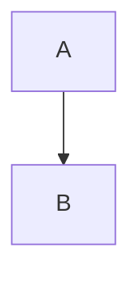

# Retry "layer" — design

This PR **adds retry** with *jittered* backoff to the `upload()` client -- because S3 returns 503 &amp; drops events... See [the docs](https://example.com/retry) :tada:. He said "we just fail" and don't \*panic\*.

We just **fail** hard here, and we just fail again.
Soft break line two  with  spaces  
hard break line three <kbd>Ctrl</kbd> and math $e^{i\pi}+1=0$ end[^1].

- [ ] Ran the integration suite
- [x] Checked idempotency on every POST
  - nested item -- one
- plain item with `code` and ~~gone~~

| Knob | Value | Why |
|------|------:|-----|
| retries | 5 | 5 × 8s = 40s |
| base | 250ms | jitter floor |

> [!NOTE]
> Retries are capped at **5** to fit the 60s job budget.

<https://example.com/auto> and www.example.org bare.

[^1]: The footnote body.

> quoted para with **bold** and "smart"
>
> second quoted para

Term one
: Definition with *emph* -- dash

Setext Heading
--------------

- loose one

  loose one continued
- loose two

## Code

```rust
fn retry() {
	let n = 5;
}
```

  ```text
  indented fence
    kept indent
  ```

    indented code block
    second line

~~~
tilde fence
~~~



```math
x^2 + y^2
```

### Quotes and details

> outer quote
>
> > inner quote with café and 🎉
>
> ### Quoted heading

<details>
<summary>More</summary>

Body paragraph inside details.

</details>

| Emoji | Note |
|-------|------|
| :tada: | naïve 🎉 |

Hidden <span hidden>secret</span> inline text.

- [ ] loose task

  continued task text
- [x] done task

* parent item
  * only child

Second ref[^2] with blocks in its note.

[^2]: Second footnote.

    - foot item

    ## Foot heading

    ```
    foot code
    ```

    | a |
    |---|
    | 1 |

| Pipe | Note |
|------|------|
| a \| b | escaped |

| Raw | Note |
|-----|------|
| a<br>b | raw break |

Raw  image and <BR/>upper break.

Graphemes 👍🏽 é 🇮🇸 ok

Spaces a&nbsp;&nbsp;b　cd end

Last line here